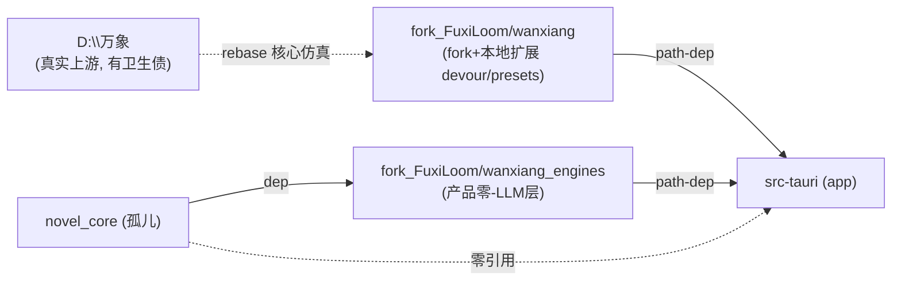

# FuxiLoom R3 上游债 / 架构治理报告

**作者**：高见远（软件架构师）　**日期**：2026-08-10　**轮次**：R3（上游债 + 架构治理）

---

## 0. 审查纪律与基线

- 全部结论来自**实际读到的磁盘文件**（`file:line` 证据）；已排除 `dist/` 构建产物与 `dist_old_*` 旧快照的仙侠文本噪声（那些是编译产物，非源码）。中文路径文件用 Read 工具直接读，未用 Bash 判存在性。
- **铁律基线**（源自 `.workbuddy/memory/MEMORY.md`）：
  - 引擎题材无关：未知/自定义 `genre` → `WorldType::Custom` → `theme.rs::neutral_theme`，绝不泄漏仙侠名/功法。
  - 命令参数 camelCase；`wx_*` 零-LLM 确定性计算器；`fnv1a32` TS/Rust 逐位一致；Tauri v1 `path_resolver` 直出。

---

## 1. 逐项现状（9 个 F 项）

### 1.1 F3 / F4 / F7 / F8（题材假设残留）— 合并叙述 + 残留清单

**R1 已修（确认落盘，非本次范围）**：
- `wanxiang_world_bridge.rs:162` `unwrap_or("custom")`（原 `unwrap_or("xianxia")`）
- `wanxiang_world_bridge.rs:199` 硬编码"灵石"→通用键"资源"
- `wanxiang_world_bridge.rs:32-33` + `:108-115` 认知层 `const_assert!` + 运行时 `assert!` 守护默认关

**残留清单（file:line 证据）**：

| ID | 位置 | 当前行为 | 严重度 | 风险分类 |
|----|------|----------|--------|----------|
| B1 | `wanxiang_world_bridge.rs:148` | `wx_wanxiang_create_from_spec` **解析失败分支** `WorldRules::for_genre(WorldType::Xianxia)` → 静默生成仙侠世界 | 中 | 安全可改 |
| B2 | `wanxiang_types/src/genres.rs:156` | `GenreConfig::for_type(t).unwrap_or_else(|| &GENRES[0])`，`GENRES[0]=Xianxia` → `Custom`/未知回退仙侠 config（`modules()` 含 Tribulation/Alchemy/Artifact/Cultivation/**Wuxing**）；`spawn.rs:52` 据此给 Custom 世界也注入仙侠模块 | 中 | 安全可改 |
| B3 | `wanxiang_types/src/genres.rs:249-250` | `modules()` 仅对 `WorldType::Xianxia \| Historical` 推 `Wuxing`（五行按**题材枚举分支**，非按模块） | 中 | 安全可改 |
| B4 | `wanxiang_types/src/rules.rs:24` + `:83` | `Default for WorldType`/`WorldRules` = `Xianxia` / `"太虚界"`（中性默认泄漏仙侠名） | 低 | 安全可改 |
| B5 | `wanxiang_types/src/genres.rs:164-198` | `for_genre` **从不设置 `world_name`**，所有题材（含 Scifi/Urban/Custom）继承 default `"太虚界"` | 低 | 安全可改 |
| B6 | `wanxiang_types/src/genres.rs:25-27` + `:235-245` | 旧 bool `has_tribulation/has_alchemy/has_artifacts` 仍在 `WorldParameters`，且是 `modules()` 的**数据源**（铁律称"已替代"不准确，实为派生自 bool） | 低 | 安全可改（内部债）/可保留 |
| B7 | `wanxiang_types/src/rules.rs:679-726` | `RealmRank` 仙侠境界枚举（炼气…仙人），全仓库**零引用（dead code）**，但一旦被调用会对任意世界渲染仙侠境界名 | 低（潜伏） | 安全可改 |
| B8 | `wanxiang_sdk/src/presets.rs:114` | `GenrePreset::generic().world_name = "太虚界"`（generic/custom 预设默认名）；`WorldModel::new` 等通用构造经 `lib.rs:64/81/95/117/390` 均载入此预设，且 `from_preset`（`lib.rs:131-132`）在 `preset.world_name` 非空时**覆盖**已中性化的 `rules.world_name`，致自定义/通用世界仍得名"太虚界" | 中 | 安全可改 |
| B9 | `wanxiang_types/src/config.rs:558` | `pub const cli::DEFAULT_NAME = "太虚界"`（CLI `--name` 默认；当前仓库内零引用，文档指向上游 `wanxiang_cli`） | 低 | 安全可改（一致性） |

> 注：B8/B9 由工程师在落地 B4（rules.rs 默认名中性化）时上报——`WorldRules` 与 `GenrePreset::generic()` 是**两条独立默认名来源**，`from_preset` 在 `preset.world_name` 非空时以其覆盖已中性化的 `rules.world_name`（见 `lib.rs:131-132`）。故 B4 单独不足以"彻底中性化"，须连 B8 一并改；B9 为 CLI 一致性伴改。

**非残留（明确排除，正确设计）**：
- `wanxiang_world_bridge.rs:49` `"xianxia"|"仙侠"|… => WorldType::Xianxia` 是 12 UI 题材→6 引擎类型的**显式映射**；catch-all `:62` → Custom；`:71` `ui_genres_do_not_silently_fall_back_to_xianxia` 单测锁死。✅ 正确。
- `theme.rs:48-69` `xianxia_theme` / `:176-192` `xianxia_tech_catalog` 是仙侠题材**自身**的名称池/功法树，属正确行为（仙侠题材就该有仙侠名），非泄漏。✅
- `src/engines/knowledgeBase/experienceLibrary.ts` 引用的 `03_xianxia.md`/`06_newxianxia.md` 是**写作参考资料**（内容资产），非引擎假设。✅

---

### 1.2 F10（食天退化）

**证据**：`wanxiang_sdk/src/presets.rs:127-221` `GenrePreset::shitian()`（`genre_id="shitian"` `:129`）；`genres.rs:269-279` `world_rules_for_genre_id("shitian")` → 不在 `GENRES` → `WorldType::Custom` + `world_name="世界"`（中性，**非 xianxia**）；`from_preset` 应用 `tuning`(:213-219) + `with_entities(build_entities())` + `with_cognitive_layers(true,true,true)`（记忆 + bridge 接线双层确认）。桥接 `wx_wanxiang_create_shitian`(:260) → `WorldModel::new_shitian(seed)`（= `from_preset(shitian)` 薄包装，保留为便捷命令，属预期）。

**结论**：**未退化**。食天 = `GenrePreset` 配置实例，题材无关铁律的工程实证。无残留泄漏。
**现状**：✅ 已解决（2026-08-09 preset 重构）。严重度 无/低。
**Watch**：若未来 `GENRES` 新增 `id` 与某 preset 的 `genre_id` 撞名需复核（当前无）。

---

### 1.3 F11（双引擎树分叉）

**证据（Glob `**/Cargo.toml`）**——实际存在 **4 个 Rust 工作区**：

| # | 工作区 | 角色 | src-tauri 依赖 |
|---|--------|------|----------------|
| 1 | `wanxiang/`（[workspace] 7 crate：types/core/brain/evolution/world/engine/sdk） | 世界**模拟**引擎 | path-dep `wanxiang_sdk`/`wanxiang_types` `:38-39` |
| 2 | `wanxiang_engines/`（[workspace] 10 crate） | FuxiLoom **产品/零-LLM 层**（NMM/causal/gate/lingming/security） | path-dep 9 crate `:26-34` |
| 3 | `novel_core/`（独立 PyO3 cdylib，dep `wanxiang_engines`） | 孤儿（见 F12） | 未依赖 |
| 4 | `src-tauri/` | app，依赖 1+2 | — |

**是否已分叉**：#1 与 #2 **非副本、非重复**——服务不同层（仿真 vs NMM/causal）。真实关系是：FuxiLoom 的 `wanxiang/`（树 B）是真实上游 `D:\万象`（树 A）的**本地 fork**，已被本地扩展（devour.rs/presets.rs/shitian_demo/gen_world），而 `D:\万象` 有卫生债（文档滞后/CRLF/无 remote/实验 .txt 被跟踪）。故 A≠B 已漂移；B 与 C 互补。



**建议方案（明确）**：**保留双源并划清边界，不合并**。
- 边界 1：`wanxiang/` = 仿真引擎（fork 自 `D:\万象`，FuxiLoom 扩展隔离在 `wanxiang_sdk/src/presets.rs` + `wanxiang_world/src/devour.rs`），定期从 `D:\万象` rebase 核心仿真，扩展层保持局部便于冲突可控。
- 边界 2：`wanxiang_engines/` = 产品零-LLM 层，随产品演进，不从 `D:\万象` 派生。
- **备选（合并 C→A）**：把 `wanxiang_engines` 合入上游 `wanxiang`。**风险**：引入上游卫生债（CRLF/无 remote/滞后文档）到产品层；破坏"wx_* 零-LLM 边界"组织清晰性；高 churn。**不推荐**。
- 严重度：战略（需决策），但建议明确。铁律校验：合并不触 camelCase/fnv1a32，但会破坏零-LLM 边界清晰度 → 反对合并的主要理由之一。

---

### 1.4 F12（novel_core 孤儿）

**证据**：`novel_core/Cargo.toml` 无 `[workspace]`，`crate-type=["cdylib"]`（PyO3 Python 扩展），dep `../wanxiang_engines/{causal_core,lingming_core,novel_writer_suite}`；`src-tauri/Cargo.toml` **未**列 `novel_core`；全仓引用仅 `src/utils/feedbackLog.ts:9` 一条注释。`novel_core/target/` 已被 `.gitignore:169` 通用 `target/` 覆盖。

**结论**：**真孤儿**。独立 PyO3 包，未被 Tauri app 使用，疑似早期"Python 集成"遗留。

**安全删除清单（真机执行，沙箱 git 写被拦）**：
1. 确认无 path-dep 指向它——✅ 已确认（仅它依赖别人，无人依赖它）。
2. 确认 `.gitignore` 已覆盖 `novel_core/target/`——✅（`target/` 通用规则）。
3. `cd D:\fork_FuxiLoom && git rm -r --cached novel_core && rm -rf novel_core`（safe-delete 守卫可能假成功，真机 `rm -rf` 兜底）。
- 风险：若有未来 Python 工具依赖则丢失；当前无。删除为单向。
- 严重度：战略（需决策：删 vs 接入）。建议删（零引用）。铁律：不涉及。

---

### 1.5 F13（桥接互调）

**证据**：`wanxiang_world_bridge.rs:538/544/547` 调用 `crate::wanxiang_bridge::{add_world_fact, wx_causal_graph_open, wx_causal_graph_add_node}`（仅 `import_to_facts` 内）；**反向（wanxiang_bridge → wanxiang_world_bridge）零引用**（`wanxiang_bridge.rs` 仅定义 `add_world_fact:1288`/`wx_causal_graph_open:224`，无 `WANXIANG_WORLDS`/`wanxiang_world_bridge` 引用）；`world_file_io.rs` 零跨模块调用（仅 fs + `assert_path_safe`）。`main.rs:16-17` 双模块声明。

**结论**：**无循环依赖 / 无互调**。仅有 `world_bridge → wanxiang_bridge` 的**单向功能依赖**（`import_to_facts` 把模拟导出注入 NMM/因果图 = "双源世界图"设计，预期）。

```mermaid
graph TD
  WX["wx_wanxiang_* 命令<br/>(wanxiang_world_bridge)"]
  WB["wx_* 零-LLM 命令<br/>(wanxiang_bridge)"]
  WF["wx_read/write_world_file<br/>(world_file_io)"]
  WX -->|import_to_facts 仅此3调用| WB
  WF -.无跨模块调用.-> X[("")]
  WB -.无回调用.- X
```

**解耦建议（可选，低优先）**：`import_to_facts` 先抽取 facts/node_names（纯函数，不依赖 `AppHandle`/`wanxiang_bridge`），再由薄协调层注入 `wanxiang_bridge`；降低对 NMM 内部签名的耦合，不改行为。
- 严重度：低。安全可改（可选重构）。铁律：`add_world_fact` 参数 camelCase 契约须保持（改其签名会破坏导入）；当前未破坏。

---

### 1.6 F14（全局 Mutex 性能）

**证据**：`wanxiang_world_bridge.rs:23-25` `lazy_static! WANXIANG_WORLDS: Mutex<HashMap<usize, WorldModel>>`；全部 11+ 命令 `WANXIANG_WORLDS.lock()` 取**整表独占锁**；读命令（info/recent_events/export/economy/report/character_mind/character_names/compare）亦取独占写锁 → 不同世界并发读被串行化；重命令（step/step_shitian/devour/fork/branch）持有全局锁全程 → 长 `step(1000)` 阻塞所有其他世界访问（含读）。`WorldModel` 内部**无** `RwLock`（grep `wanxiang_sdk/src` 零匹配）→ 全局 `Mutex` 是唯一同步，过度串行化。

**当前锁粒度**：表级独占（最粗）。
**重构建议**：
- 方案 A（最小）：`Mutex` → `RwLock<HashMap<usize, WorldModel>>`；读 `.read()` 并发，写 `.write()`。改动小，并发读立即解耦。
- 方案 B（推荐，每世界锁）：`RwLock<HashMap<usize, Arc<RwLock<WorldModel>>>>`（或 `DashMap<usize, Arc<RwLock<WorldModel>>>`——`dashmap` 已是 `wanxiang/Cargo.toml:24` 依赖）。`step(world A)` 只锁 A 内层 RwLock；读 B 不受影响。彻底解耦多世界。
- 方案 C（消息传递）：每世界 channel。过度。
- 严重度：中（吞吐悬崖；当前单用户单会话影响有限，但是设计 smell + step 全局阻塞）。安全可改（纯内部 Rust，不触 fnv1a32/camelCase/wx_* 铁律）。
- 注意：`fork`/`branch` 现有"先读锁 `map.get` → 再写锁 `map.insert`"双锁模式（`:388-396`/`:411-425`/`:430-443`）须在新结构下重写（用 `Arc` 克隆），并加死锁回归测试。

---

## 2. 整改设计（可改项 · 是否触铁律）

| 项 | 改法 | 触铁律？ |
|----|------|----------|
| B1 | `bridge:148` 解析失败分支 `WorldRules::for_genre(WorldType::Xianxia)` → `WorldRules::for_genre(WorldType::Custom)` | 否 |
| B2 | `genres.rs:156` `for_type` 增 `WorldType::Custom` 显式分支，返回中性静态配置（或复用 `world_rules_for_genre_id` 思路） | 否 |
| B3 | `genres.rs:249-250` 推 `Wuxing` 改为基于 `GenreConfig` 新字段 `has_wuxing: bool`（Xianxia/Historical=true，其余 false），消除"按 world_type 枚举分支" | 否（增强模块驱动） |
| B4 | `rules.rs:24` `Default for WorldType`→Custom；`:83` `WorldRules::default().world_name`→"世界" | 否 |
| B5 | `for_genre` 各已知题材分支补 `r.world_name`（来自 `GenreConfig.label` 或中性名）；Custom 分支设"世界" | 否 |
| B6 | 保留 bool 作 `modules()` 数据源（当前可），或反向（modules 为源、bool 派生）；建议保留并修正记忆措辞 | 否 |
| B7 | 删除 `RealmRank` 枚举（确认零引用）；若需境界名渲染，改用 `GenreConfig::for_type(wt).power_levels[bucket]`（已按题材提供） | 否 |
| B8 | `presets.rs:114` `GenrePreset::generic().world_name` `"太虚界"`→`"世界"`（与 `world_rules_for_genre_id("custom")` 中性默认一致） | 否 |
| B9 | `config.rs:558` `cli::DEFAULT_NAME` `"太虚界"`→`"世界"`（CLI 默认一致性伴改） | 否 |
| B-TS | `worldFileImport.ts:29` `detectGenre` 默认 `'xianxia'`→`'custom'`；`worldFileImport.test.ts:155` 同步改期望 | 否（对齐"未知→Custom"）；**行为变更→标记需决策** |
| F13 | `import_to_facts` 抽取纯函数 + 薄协调注入（可选） | 保持 `add_world_fact` camelCase 签名 |
| F14 | 全局 `Mutex` → `RwLock<HashMap<usize, Arc<RwLock<WorldModel>>>>`（方案 B 推荐） | 否 |

---

## 3. 任务分解（有序 · 依赖 · 分类）

| Task | 名称 | 依赖 | 分类 / 优先级 |
|------|------|------|----------------|
| T01 | F3/F4/F7/F8 引擎层残留清除（B2/B3/B4/B5/B6/B7：genres.rs/rules.rs；**B8/B9：presets.rs/config.rs 默认名中性化**） | 无 | **安全项**（工程师寇豆码）P1 |
| T02 | F3/F4/F8 桥接层残留清除（B1 bridge:148） | 无 | **安全项** P1 |
| T03 | F3/F4/F8 TS 层残留（B-TS worldFileImport.ts:29 + test） | 无 | **安全项**（默认改 custom 需决策）P1 |
| T04 | F14 全局锁重构（RwLock/per-world，含 fork/branch 重写 + 死锁测试） | 无 | **安全项** P2 |
| T05 | F13 解耦（import_to_facts 抽取纯函数，可选） | 无 | **安全项（可选）** P3 |
| T06 | F11 双源边界确认（保留不合并；写 MEMORY 边界说明 + 同步纪律） | 用户拍板 | **战略项** P1-战略 |
| T07 | F12 novel_core 删除（真机 `git rm -r --cached` + `rm -rf`；确认无引用） | 用户拍板 | **战略项** P1-战略 |
| — | F10 已解决，不入任务；watch 项并入 T06 注释 | — | — |

> **安全项** = T01–T05（工程师可直接落地，真机 `cargo check`/`tsc --noEmit`/`npm run test:ts` 复核）。
> **战略项** = T06/T07（需用户拍板，见 §4）。

---

## 4. 需用户决策项（供主理人拿去拍板）

| 项 | 建议方案 | 备选 | 各自风险 |
|----|----------|------|----------|
| **F10** | 维持现状（已正确，食天=GenrePreset 实例） | 未来正式登记食天为 `GENRES` 成员 | 无风险；登记需评估与 preset 层重复 |
| **F11** | 保留双源 + 划清边界，**不合并** | 合并 `wanxiang_engines`→`wanxiang` | 建议风险低（边界清晰、演进独立）；备选风险高（引入上游卫生债 CRLF/无 remote/滞后文档；破坏零-LLM 边界；高 churn） |
| **F12** | **删除** novel_core（零引用孤立 PyO3 包） | 接入（为 Python 工具保留） | 建议风险低（当前无消费者）；备选会与 Tauri 架构冲突且无消费者 |
| **B-TS(F8 TS侧)** | `detectGenre` 默认改 `'custom'`（对齐"未知→Custom"铁律） | 保持 `'xianxia'`（模糊文本默认得仙侠世界，体验连续） | 建议符合铁律但改用户可见默认世界类型；备选违反"未知→Custom" |

---

## 5. 铁律校验

- 所有建议**均不触**：题材无关（反而强化）、camelCase 命令（不改命令签名）、`wx_*` 零-LLM（不动逻辑）、`fnv1a32` 跨端锁（未涉及哈希）、Tauri v1 `path_resolver`（未涉及）。
- **唯一行为契约注意**：
  - F13 解耦须保持 `add_world_fact` camelCase 参数形状；
  - B-TS 改默认会改用户可见默认世界类型（需确认是否对齐铁律）。
- F11 合并方案会破坏"wx_* 零-LLM 边界"组织清晰性 → 故反对合并。

---

## 6. 残留清单速查表（file:line）

| ID | file:line | 当前 | 改法 | 严重度 | 分类 |
|----|-----------|------|------|--------|------|
| B1 | wanxiang_world_bridge.rs:148 | 解析失败→Xianxia | →Custom | 中 | 安全 |
| B2 | wanxiang_types/src/genres.rs:156 | for_type 未知→GENRES[0]=Xianxia | Custom 显式分支 | 中 | 安全 |
| B3 | wanxiang_types/src/genres.rs:249-250 | Wuxing 按 world_type 枚举分支 | has_wuxing 字段驱动 | 中 | 安全 |
| B4 | wanxiang_types/src/rules.rs:24,83 | Default= Xianxia/"太虚界" | →Custom/"世界" | 低 | 安全 |
| B5 | wanxiang_types/src/genres.rs:164-198 | for_genre 不设 world_name→"太虚界" | 补 world_name | 低 | 安全 |
| B6 | wanxiang_types/src/genres.rs:25-27,235-245 | 旧 bool 为 modules() 源 | 保留/反向 | 低 | 安全 |
| B7 | wanxiang_types/src/rules.rs:679-726 | RealmRank 仙侠境界（dead code） | 删除/改 power_levels | 低 | 安全 |
| B8 | wanxiang_sdk/src/presets.rs:114 (+ lib.rs:64/81/95/117/131-132) | generic 预设 world_name="太虚界" 覆盖中性名 | →"世界" | 中 | 安全 |
| B9 | wanxiang_types/src/config.rs:558 | CLI 默认名 DEFAULT_NAME="太虚界" | →"世界" | 低 | 安全 |
| B-TS | src/engines/wanxiang/worldFileImport.ts:29 | detectGenre 默认 xianxia | →custom | 低 | 安全(需决策) |
| F10 | presets.rs:127-221 / genres.rs:269-279 | 食天=Custom 中性+调参 | 已解决 | 无 | — |
| F11 | wanxiang/ + wanxiang_engines/ (各 [workspace]) | 双源互补，B 是 A 的 fork | 保留不合并 | 战略 | 需决策 |
| F12 | novel_core/Cargo.toml | 孤儿 PyO3，零引用 | 删除 | 战略 | 需决策 |
| F13 | wanxiang_world_bridge.rs:538,544,547 | world→wanxiang_bridge 单向 | 可选解耦 | 低 | 安全(可选) |
| F14 | wanxiang_world_bridge.rs:23-25 | 全局 Mutex 整表独占 | RwLock/per-world | 中 | 安全 |
