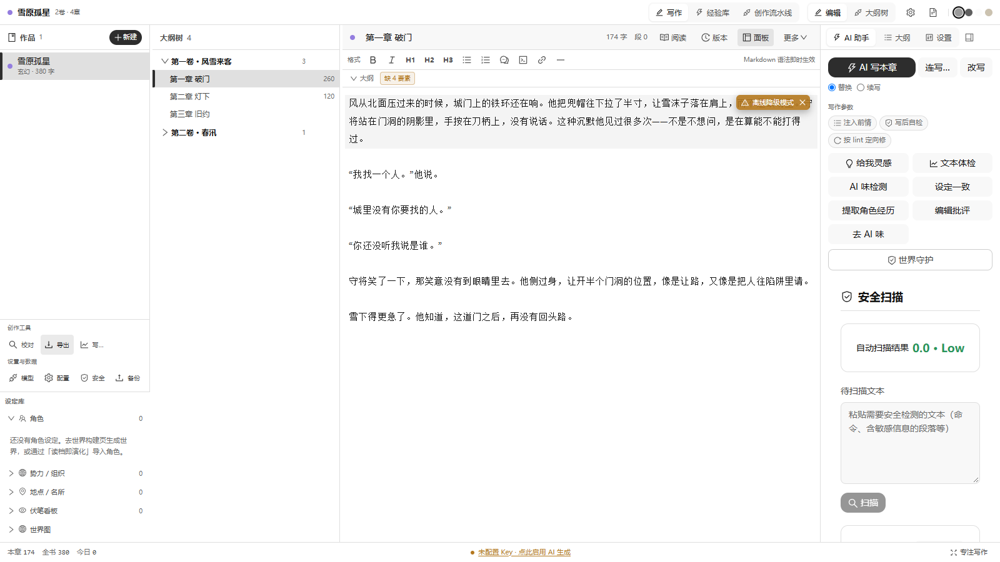
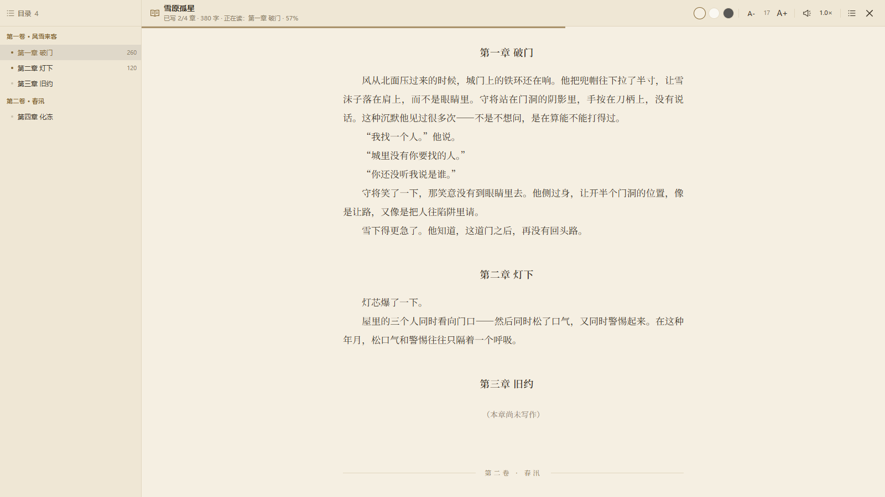
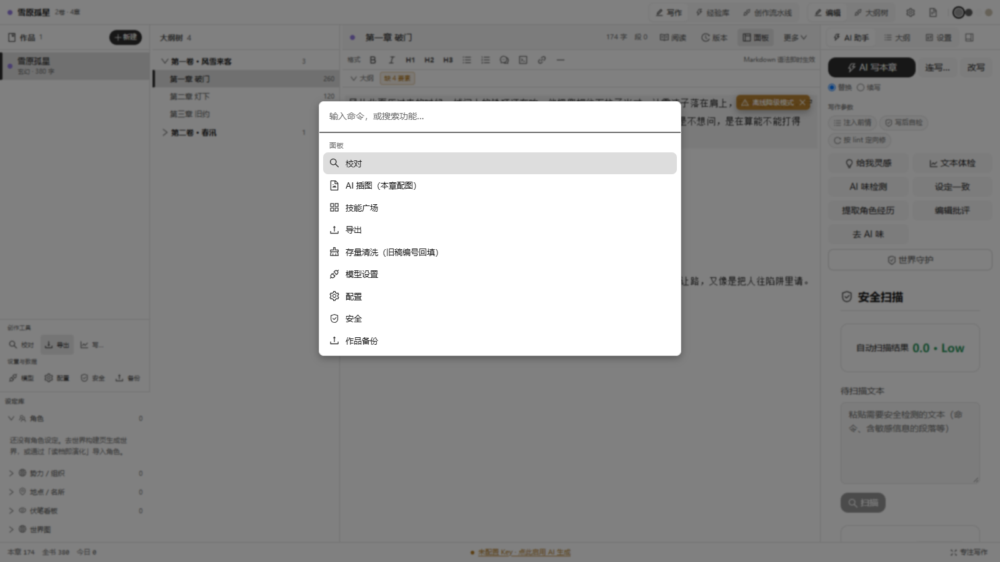

# 墨织 InkWeave（原 FuxiLoom）

> 面向长篇小说与网络文学创作的 AI 桌面工作台<br>
> 当前版本：**V10.1.1**
<!-- CI 徽章：推送到 GitHub 后取消下面两行注释，把 USER/inkweave 替换为实际用户名/仓库名即可显示 CI 状态：
[](https://github.com/USER/inkweave/actions/workflows/ci.yml)
-->

**墨织 InkWeave**（原名 FuxiLoom）是一款基于 Tauri、React、TypeScript 与 Rust 构建的桌面端小说创作工具。项目以完整的“作品工程”为核心，把灵感构思、角色与世界观管理、卷章规划、正文写作、AI 协作、质量分析、审校修改和稿件导出整合到同一工作区。

它不是一个只负责续写的聊天窗口。系统会围绕作品结构组织上下文，让 AI 在明确的角色、设定、时间线、前文章节和创作规则下工作；正文生成前后还会经过设定一致性、世界守护与质量门禁的校验，减少长篇创作中的人物失真、设定冲突、情节断裂和文风漂移。

## 截图

| 写作台（三栏 + AI 助手） | 阅读模式（整书成品渲染） |
| --- | --- |
|  |  |

命令面板（Ctrl / ⌘ + K），全功能一键盘达：



## 项目定位

**FuxiLoom 是一款本地优先、引擎驱动的 AI 长篇小说创作工作台。** 它不只是一个续写聊天框，而是用 Rust 自研的确定性世界引擎（万象栈）保证世界观自洽——势力演化、人物动机、事件因果可复现（drift≈0），让 AI 写作长在可信的世界模型之上，而非凭空生成文字。

FuxiLoom Novel Writer Ai 主要服务于：

- 需要管理多部作品、多卷多章和大量设定的长篇小说作者。
- 关注开篇钩子、爽点节奏与读者留存的网络文学创作者。
- 创作需要严密世界观与长线设定的作者——世界引擎题材无关，仙侠、都市、科幻、西幻皆可建模，因果链与守恒律让宏大世界观不崩盘。
- 希望让多个 AI 角色参与起草、审校、复核和整合的创作团队。
- 需要本地保存、版本历史、模型自由配置和桌面文件导出的个人用户。
- 希望建立“规划、创作、检测、修改、复检”闭环的内容生产者。

核心工作流：

```text
灵感与作品定位
  -> 角色 / 世界观 / 时间线 / 故事画布
  -> 卷纲 / 章纲 / 伏笔规划
  -> 编辑器或 AI 生成
  -> 质量评分 / 故事性 / 节奏 / AI 痕迹 / 错字分析
  -> 定位问题并修改
  -> 复检 / 导出
```

## 功能全景

| 模块 | 主要能力 |
| --- | --- |
| 作品工程 | 多作品、多卷、多章、作品资料与创作风格管理 |
| 正文编辑 | CodeMirror 编辑器、隐藏模板注释、打字机滚动、Vim 键位、选区续写改写、多版本草稿、写作冲刺计时（15/25/45 分钟 + 净增字数） |
| AI 协作 | 写本章 / 续写 / 连写（配置跨会话记忆、按作品分键、「继续上次」一键续跑）/ 改写、六步写作管线、多角色审校、自动全流程、灵感工坊（命名/场景点子一键生成 + 灵感收藏）、AI 稿 8 秒撤销条（润色/版本回退/AI 写作路径全覆盖）、连写整批回退（终态进度卡一键恢复旧稿，AI 稿自动存为版本，V8.8.0） |
| 设定系统 | 角色、关系图、世界观、势力、时间线、卷纲、章纲、故事画布 |
| 故事矿脉 | 世界矿脉探测（Top-N 故事候选 + 戏剧性评分）、实时监听（新矿脉 / 升温 / 降温 / 沉寂 diff）、分支探索对比与批量播种、世界编年史时间轴（缩放细读）、一键生成卷纲/章纲草案、世界包导出导入、关系图谱 2.0（力导向/过滤/实体档案/时间切片 + 大图交互：滚轮缩放/拖拽平移/节点微调/子图聚焦/标签避让）、分支 What-if AI 故事化推演（可收藏为灵感） |
| 阅读与听书 | 整书成品渲染（纸面/白底/夜间三主题、衬线排版、目录侧栏、字号调节、阅读进度记忆与进度条）；本地语音合成听书（句级高亮跟随、自动滚屏、章末接续、语速切换、书末轻提示） |
| 经验库 | 内置匠艺手册与自建经验、分类浏览与搜索、引用到正文、作品与世界设定导入 |
| 本地 Skills | 按任务注入创作规范，约束连续性、角色、文风、伏笔和内容质量 |
| 内容分析 | 质量评分、故事性评估、节奏张力、AI 痕迹检测、错字校对、文本体检与设定一致性、节奏看板（张力曲线×伏笔种收×情绪标签 + 节奏诊断 + 章卡「AI 提张力」一键回流 + 多选批量回流）、一致性检查（角色沉睡/复读句式/无纲裸写/伏笔悬置/字数离群/角色名歧义/代词性别翻转/AI 口头禅聚集，零 LLM 确定性规则） |
| 情节网格 | 全书「章节 × 故事线」矩阵（角色/势力/**地点**/伏笔四线推进强度分档、空白带警示、列宽三档、角色/地点线上限可调（V8.8.0 地点上限入偏好）、活跃优先选线、地点名+别名匹配，V8.5.0） |
| 世界可视化 | 顶层世界星图直达（3D 星图 / 2D 版图 / 时间轴三视图、最近世界一键切换）、星图内建新建世界（题材 / 种子 / 演化步数三参数确定性生成，V8.4.0）、选中实体详情卡 + 大事记时间线（V8.5.0）、大事记点击跳时间轴回放定位、大事记重要度/事件类型双筛选（显 M/共 N 计数，V8.8.0） |
| 文风红线 | entityGuard 实体守卫（char_70 类内部编号确定性改名 + outcome 等模拟字段残留红线）、AI 口头禅黑名单 20 条、明喻密度上限、薄章下限、节拍轮换（六开场×五张力曲线按章错峰）——写作管线自动拒稿重写，源头章纲同步清洗；阈值面板化（localStorage 持久化，即调即生效）；风格预设（仙侠古雅/现代爽文/悬疑冷硬/言情细腻/科幻克制五档一键切换，生成期注入文风指令 + 检查期套用对应阈值，V6.2.0）；存量清洗（旧章纲/正文一键确定性回填，零 LLM 幂等，含 before/after 改动预览） |
| 结构化输出 | 写作管线场景分析/角色状态/对话设计三步接入约束解码——llama.cpp/云端 response_format json_schema、Ollama 原生 format，端点不支持自动剥离重试 + 裸调用兜底（2025-2026 业界共识，JSON 解析失败率趋零） |
| 多语言界面 | 命令面板/设置面板全量 i18n（zh/en/ja，819 词条），阈值/清洗/主题切换英文化，tf() 参数化词条 |
| 数据与导出 | 本地保存、历史快照与自动备份、项目导入导出、EPUB / TXT / Markdown / PDF |

## 作品工程与编辑器

- 按作品、卷、章管理长篇内容，保存书名、题材、风格、简介和章节结构。
- 支持新增、编辑、删除、移动和批量组织章节。
- 编辑器基于 CodeMirror，提供隐藏模板注释、打字机滚动、Vim 键位等专注写作选项。
- 导出时可选用中文排版（CJK 与英文/数字间加空格）。
- 支持 Markdown 选区格式（加粗 / 斜体 / 代码 / 链接）、AI 写本章、续写、整章改写与提质润色。
- 支持基于分析报告的定向润色（按风格检测逐条改写对应句段，不改情节与事实）。
- 通过章节多版本草稿保存正文历史快照，支持预览、回退与版本对比；整库另有自动滚动快照备份。
- 统计作品字数、卷章分布与设定规模，帮助作者掌握当前创作进度。
- 拆书·对标（V9.8.0）：导入外部书过同一套度量流水线，与自己作品同轴对比出可解释的结构报告（浓度均线 / 六维度 / 学习要点 / 重灾章直达），离线零 AI 调用。

## AI 协作工作流

AI 协作以「章节」为中心，从编辑器右栏的「AI 助手」页签触发，全部走用户自配的 OpenAI 兼容接口。

### AI 写本章 / 续写 / 连写 / 改写

- **AI 写本章**：结合章纲、前情、角色状态、世界简报与目标风格生成整章正文，可切换「替换」或「续写」模式。
- **连写**：按顺序连续生成后续多章，每章落盘后再写下一章；绑定世界时一次性推进世界进度。上次连写配置跨会话记忆（按作品分键），进度卡终态与弹层双入口「继续上次」一键续写剩余未写章。
- **改写**：对已有正文整章重写，可选「提质润色」（增强画面感、去 AI 味、修语病，不改情节与事实）或「按风格检测定向润色」（逐条改写命中的问题句段）。

### 六步写作管线

生成过程按「场景分析 → 角色状态 → 对话设计 → 叙述框架 → 对话生成 → 融合润色」六步推进，中间结果在编辑器中可见；任一步不可用时自动降级为直接生成。

### 多角色审校

草稿生成后，可启用多个审校角色依次多 pass 打磨，角色包括审校师（逻辑 / 事实 / 人设）、总编（结构 / 节奏）、裁决者（冲突定稿）与文笔终审（去 AI 味 / 语言质感）。每个角色可在模型设置中独立选择账户、模型与提示词，实现「本地快模型起草 + 云端强模型审校」的混合流。每次审校的记录（改了多少、是否采纳、为何被拒）可见。

### 自动全流程

根据一句创作需求，依次完成作品定位、世界观、角色、卷纲、章节规划与细纲，产出可继续写作的作品骨架。

### 写作过程中的辅助能力

- **给我灵感**：围绕当前章给出可选的走向与桥段。
- **文本体检 / AI 味检测 / 设定一致 / 世界守护**：就地做确定性检查，命中问题可直接进入定向修改。
- **提取角色经历**：从正文中抽取角色成长节点，写入角色弧光供后续章节引用。
- **Skills 与反馈**：按任务类型注入创作规范；技能命中与审校反馈会被记录，供后续同类任务参考。

## 角色、世界观与经验库

- 维护角色档案、人物关系与角色心智（情绪、性格、目标、关系强度），辅助检查人物立场和互动关系。
- 管理世界规则、背景条目、势力结构和时间线事件。
- 使用卷纲、章纲和故事画布（premise → 卷 → 章的节点树视图）拆分长篇结构。
- 通过章节摘要记录剧情进展、出场人物和待回收伏笔。
- 经验库内置 6 篇匠艺手册（写作方法论、番茄爆款爽文、仙侠玄幻爽文、万象世界演化系统等），并支持用户自建经验条目，提供分类浏览、关键词搜索与「引用到正文」。
- 支持导入整部作品（纯文本 / Markdown 自动切卷切章）与世界设定文件（.json / .md / .txt → 可演化世界）。
- 内置网络文学类型与标签资料、6 篇匠艺手册，以及覆盖多个中文平台与日系轻小说投稿方向的平台清单。

## 本地 Skills

Skills 是可编辑的 Markdown 创作规则，可以全局启用，也可以绑定到单个作品。系统会根据任务类型和触发词选择合适的 Skill，将规则注入生成上下文。

项目内置小说质量与规范 Skill，重点约束：

- 章节与前情连续性。
- 人物行为、知识边界和角色声音一致性。
- 叙事风格、场景具体性与自然节奏。
- 伏笔埋设、推进与回收。
- 平台规范、证据边界和成稿质量。

Skill 不以制造错字、随机噪声或规避检测为目标，而是用于提升文本质量、作者可控性和内容可发表性。

## 分析、检测与审校

### 质量评分（共享 rubric）

用一套确定性、零 LLM 的公式给章节打分（0–100）：去 AI 味（40）+ 节奏张力（30）+ 文风真人化（30）− 硬约束扣分（≤30）。硬约束来自与去 AI 味规则同源的禁用套话词表、叠词密度与破折号密度。同一段文本在任何时候都得到同一个分数，便于修改前后对比。

### 故事性评估

在质量门（因果 / OOC）之后对章节做多维度故事性评估：情节推进度、冲突密度、张力曲线、章末钩子强度、情绪弧线与读者满足度。采用「规则检测打底 + 可选 LLM 深度评估」的混合评分；未通过时自动触发重写（有次数上限），LLM 不可用时仅用规则检测，不阻塞写作流。

### 节奏张力分析

以确定性启发式（标点能量、短句爆发、对话密度、冲突 / 情绪词密度）把每章正文折算成 0–10 的张力分数，并在编辑器中可视化为全书曲线，一眼看出节奏是否偏平或一路高潮；点击任意点可跳章。

### AI 痕迹检测

以本地模板句库匹配（命中万能句、套话及其上下文）配合内置 LNN 确定性模型（`ai_score`）给出 AI 味信号，并输出 16 维文本特征明细与节奏张力、文风调制方向。检测结果用于辅助审校，不把单一分数作为文本来源的确定结论。

### 错字与校对

- 本地规则优先识别固定词组误写、重复虚词、连续标点和明确格式问题。
- 可调用 AI 进行语境复核，补充同音字、近形字和上下文用词问题。
- 对问题给出原文、建议、原因、来源和置信度，支持定位与修改。

### 文本体检与世界一致性

- **文本体检**：统计 token 数、句数、均句长与重复段落，定位赘余与复读。
- **设定一致 / 世界守护**：把本章与前文已确立的设定、世界事实比对，检出硬冲突并给出前文出处，可直接进入定向修改。

## 翻译与朗读

### 出海翻译（已实装，2026-09-17）

- 术语表、整本翻译（独立 API 配置）与译文浏览，入口在命令面板「出海翻译」；译文可单独朗读。

### 朗读（TTS，已实装）

- 基于 WebView2 内建 Web Speech API 的本地语音合成，零依赖零网络（语音来自 Windows 系统本地语音）。
- 编辑器内可朗读当前章；翻译面板可朗读译文。
- **听书模式**（阅读视图内）：整书连续朗读——当前段落高亮跟随、自动滚屏、章末自动接续下一个已写章（未写章自动跳过）、语速循环切换（0.8–2.0×，持久化）、目录点击即「从这章接着听」。
- 工程坑对策内置：超长段落按句切块防引擎截断、voices 异步等待、中文语音优先择声、Chrome 系 15s 自动暂停 bug 幂等恢复、同一时刻单一朗读任务互斥。

## 数据、隐私与备份

- 作品、设置、经验库、分析缓存与创作历史主要保存在本机。
- 正文历史与滚动快照保存在本机 Local Storage（快照保留最近 5 份）；桌面端在保存作品时还会自动将整库快照写入应用数据目录的 `fx_backup/`，保留最近 10 份，作为防清缓存的第二道防线。
- 支持导出完整项目数据（全库打包为一份 JSON 备份），也可导出便于人工整理的单部作品文本。
- 导入项目会覆盖当前作品和相关资料，操作前应先导出备份。
- 应用不提供默认云同步。调用 AI 服务时，相关文本会发送到用户配置的服务提供方，请自行确认其隐私政策。
- Tauri 的持久化标识保持为 `com.novel.writer`，避免产品改名或升级后切换到新的应用数据目录。

## 模型与服务配置

- 使用 OpenAI 兼容接口接入云端或本地模型。
- 支持保存多个服务商账户，供不同任务与角色分别取用。
- 可连接 OpenAI、DeepSeek、SiliconFlow 等兼容服务，也可连接本机 Ollama 兼容地址。
- 各写作角色（大纲策划 / 正文起草 / 审校师 / 总编 / 裁决者 / 文笔终审）可独立选择账户、模型与提示词，实现「本地起草 + 云端审校」的混合流。
- 请求支持流式响应、超时处理和兼容性配置。

## 导出能力

导出范围：

- 单部作品：当前作品全文（EPUB / TXT / Markdown / PDF）。
- 单部作品工程文件：`.fxnovel`（可再次导入）。
- 全库：所有作品打包为一份 JSON 备份。

导出内容：

- 原文（标题、作者、简介、卷章正文）。
- 含角色、世界观、大纲等作品内资料的完整记录（全库 JSON 备份，不含经验库与模型配置）。

导出格式：

- EPUB（含封面、作者、语言、简介等元数据）。
- TXT（纯文本）。
- Markdown。
- PDF（调起系统打印对话框另存）。

## 技术架构

| 层级 | 技术与职责 |
| --- | --- |
| 桌面端 | Tauri 2.x、Rust，负责窗口、文件系统、安装包和桌面能力 |
| 前端 | React 19、TypeScript、Tailwind CSS |
| 构建 | Vite 7、npm、Cargo |
| 世界引擎 | Rust 双工作区：wanxiang_engines（确定性核心 10 crate：世界态守恒、因果核心、安全套件等）+ wanxiang（万象模拟引擎 7 crate），经 Tauri bridge 接入 |
| AI 接入 | OpenAI 兼容接口、本地模型、流式请求 |
| 创作引擎 | 章节生成、六步写作管线、多角色审校、世界简报与质量门禁 |
| 分析引擎 | 质量评分、故事性评估、节奏张力、AI 痕迹、错字与设定一致性 |
| 数据层 | Local Storage、Tauri 文件系统 |

主要目录：

```text
src/assets/       静态资源与创作方法论资料
src/components/   应用外壳、编辑器、侧栏、分析面板、设置与业务弹窗（App / Modals / UI）
src/engines/      万象引擎（wanxiang）与经验库（knowledgeBase）
src/i18n/         中英日文案与类型 / 标签 / 平台资料
src/styles/       全局样式与主题令牌
src/types/        作品、角色、世界等数据模型
src/utils/        AI 请求、存储、备份、Skills、校对与导出工具
wanxiang_engines/ Rust 确定性引擎工作区（世界态守恒、因果核心、记忆、安全等 10 crate）
wanxiang/         万象模拟引擎工作区（世界生成与演化 SDK，Tauri 桥接依赖）
src-tauri/        Tauri / Rust 桌面端配置与命令
skills/           本地小说创作 Skills
scripts/          本地门禁与自检脚本（ci-check / check-boundary / verify_offline_core 等）
docs/             设计文档、AI 检测机制与开发记录
outputs/          验收清单、核验报告与优先级盘点
```

## 开发与构建

### 环境要求

- Node.js 18+
- npm
- Rust stable
- Windows WebView2

### 安装依赖

```bash
npm install
```

### 浏览器开发模式

```bash
npm run dev
```

### Tauri 桌面开发模式

```bash
npm run tauri dev
```

### 生产构建

```bash
npm run build
npm run tauri build
```

## 测试

```bash
npm run test:ts          # 前端单测（vitest，src/ 全量）
npm run test:e2e         # E2E 冒烟（Playwright + 系统 Edge，浏览器模式确定性链路）
npm run test:rust        # 引擎 Rust 单测（wanxiang_engines 工作区）
npm run test:tauri       # Tauri 桥接层单测（src-tauri）
npm run check:boundary   # 定位边界审计（死命令 / 幽灵调用 / 死配置 / 未挂载命令 / TS 孤岛）
npm run verify:community # 开源双轨校验：社区版副本剥离不变量 + 版本同步 + tsc 编译（发版前跑）
npm run ci               # 本地门禁八步：边界审计 → tsc → vitest → vite build → cargo check → 三套 cargo test → 离线核心自检
node scripts/verify_offline_core.ts   # 零依赖离线核心自检（LNN + 离线词向量 RAG，6 项）
```

## 推荐使用流程

1. 新建作品，填写书名、题材、风格与简介。
2. 建立角色、人物关系、世界观、势力、时间线、卷纲和章纲。
3. 配置 AI 服务账户、各写作角色的模型和本地 Skills。
4. 使用编辑器与「AI 写本章 / 连写 / 改写」管线生成和修改内容。
5. 运行质量评分、节奏张力、AI 痕迹、错字与设定一致性分析。
6. 根据报告定位问题，完成修改并重新检测。
7. 导出整部稿件（EPUB / TXT / Markdown / PDF）或全库备份。

> AI 输出和自动分析可能包含事实错误、文风偏差、漏检误判或不符合发布平台要求的内容。正式发布前，应由作者完成审阅、校对、事实核验和版权风险检查。

## 关于本仓库（完整版全量开源）

本仓库即墨织 InkWeave **完整版**：写作全链路 + 万象确定性世界模拟引擎（Rust，双工作区 17 crate）+ 全部能力域，以 Apache-2.0 全量开源——包括离线 LNN 推理、离线词向量 RAG、3D 星图、故事矿脉、拆书·对标、出海翻译、连写多章等。

历史上曾规划「开源双轨」（社区版剥离世界模拟引擎），后决定全量开源。`scripts/split-community.mjs` 剥离产线保留在库中，如需精简发行版可自行裁剪使用。

## 社区参与

欢迎参与墨织 InkWeave 社区：

- **Bug 报告 / 功能建议**：请通过 [Issue 模板](.github/ISSUE_TEMPLATE/) 提交（仓库上线后启用）
- **使用问答 / 想法交流**：请到 GitHub Discussions（仓库上线后启用）
- **代码贡献**：请阅读 [`CONTRIBUTING.md`](CONTRIBUTING.md)，提交 PR 前对照 [PR 模板](.github/PULL_REQUEST_TEMPLATE.md) 自检四门禁
- **行为准则**：所有参与者请遵守 [`CODE_OF_CONDUCT.md`](CODE_OF_CONDUCT.md)
- **安全漏洞**：请按 [`SECURITY.md`](SECURITY.md) 私密报告，不要在公开 Issue 中报告

## 社区参与

欢迎参与墨织 InkWeave 社区：

- **Bug 报告 / 功能建议**：请通过 [Issue 模板](.github/ISSUE_TEMPLATE/) 提交（仓库上线后启用）
- **使用问答 / 想法交流**：请到 GitHub Discussions（仓库上线后启用）
- **代码贡献**：请阅读 [`CONTRIBUTING.md`](CONTRIBUTING.md)（社区版仓库内），提交 PR 前对照 [PR 模板](.github/PULL_REQUEST_TEMPLATE.md) 自检四门禁
- **行为准则**：所有参与者请遵守 [`CODE_OF_CONDUCT.md`](CODE_OF_CONDUCT.md)
- **安全漏洞**：请按 [`SECURITY.md`](SECURITY.md) 私密报告，不要在公开 Issue 中报告

## 社区参与

欢迎参与墨织 InkWeave 社区：

- **Bug 报告 / 功能建议**：请通过 [Issue 模板](.github/ISSUE_TEMPLATE/) 提交（仓库上线后启用）
- **使用问答 / 想法交流**：请到 GitHub Discussions（仓库上线后启用）
- **代码贡献**：请阅读 [`CONTRIBUTING.md`](CONTRIBUTING.md)（社区版仓库内），提交 PR 前对照 [PR 模板](.github/PULL_REQUEST_TEMPLATE.md) 自检四门禁
- **行为准则**：所有参与者请遵守 [`CODE_OF_CONDUCT.md`](CODE_OF_CONDUCT.md)
- **安全漏洞**：请按 [`SECURITY.md`](SECURITY.md) 私密报告，不要在公开 Issue 中报告

## 鸣谢

本项目的界面图标使用 [Ant Design Icons](https://github.com/ant-design/ant-design-icons)（MIT License，© 2018-present Ant UED）。在此向其作者与社区表示感谢。

同时感谢 Tauri、React、Vite、ReactFlow、JSZip 等开源项目，本工具站在这些社区的工作之上构建。各依赖的许可证及完整声明见仓库根目录 [THIRD-PARTY-NOTICES.md](THIRD-PARTY-NOTICES.md)。

## 开源协议与版权

本项目采用 **Apache License 2.0**。完整协议见仓库根目录 [LICENSE](LICENSE)。

The source code in this repository is licensed under the Apache License, Version 2.0

Copyright [2025] 猫猫大人

## 作者

猫猫大人
